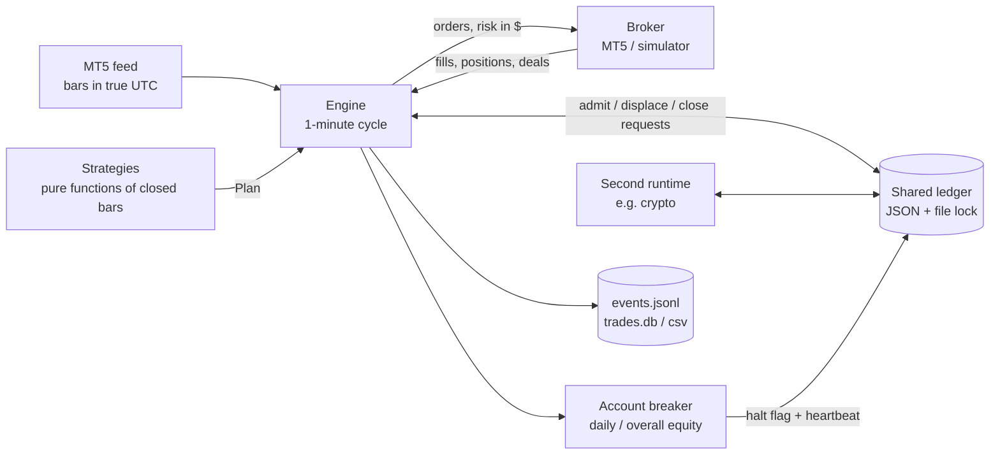

# tradebot — a multi-strategy MetaTrader 5 trading engine with prop-firm risk controls


The engine and research toolkit behind a private, automated intraday trading system that runs several strategies across
US indices, the DAX, gold and crypto on **prop-firm accounts** (funded accounts with hard daily and overall loss limits).

> **What is and isn't here.** This public repository contains the production engineering — order handling, risk
> controls, crash recovery, the multi-process position book, the broker clock — and the research method used to decide
> which strategies are real. The **live strategies themselves stay private**; the engine ships with a textbook
> opening-range breakout as a runnable example.

## Why it is built the way it is

A prop-firm account is closed the moment equity breaches a daily or overall limit — one bad afternoon ends it. So the
design priority is not "find trades", it is **never let the plumbing turn a normal loss into a breach**:

| Concern | How the engine handles it |
|---|---|
| Account loss limits | Equity-based daily / overall **circuit breaker** (floating P&L included), persisted across restarts, bound to the broker login so a new account gets a fresh budget automatically ([`safety.py`](tradebot/safety.py)) |
| Too much risk at once | **One shared book** across processes: max N open, ranked displacement, account-wide open-risk cap, behind a cross-process file lock ([`ledger.py`](tradebot/ledger.py)) |
| Slow drawdowns | **Drawdown cascade** — stakes x0.5 / x0.3 below the starting balance ([`risk.py`](tradebot/risk.py)) |
| Process dies mid-trade | Stops and targets always live **at the broker**; on restart positions are adopted from the broker and the deal history stops a day being traded twice |
| Broker rejects a close | The position stays tracked and the close is retried every cycle — never silently forgotten |
| Terminal restarts / updates | A failed position query is an **error, not "flat"**; the engine reconnects every cycle |
| Broker server clock | MT5 stamps everything in server time with DST switches: offset measured from fresh ticks, cached, applied **per bar** ([`mt5_clock.py`](tradebot/mt5_clock.py)) |
| Late signals | A market entry more than 2 minutes late is skipped, a breakout already through its level is not chased — a worse price selects the losers |
| Contract size | A trade whose minimum lot already risks > 1.5x its stake is refused |
| Laptop sleeps | Windows Modern Standby froze a live agent once: the process now holds the system awake |
| Audit trail | Every decision **including refusals** is one JSON line: "did live do what the backtest did?" is answerable |

## Architecture



Each cycle ([`runtime.py`](tradebot/runtime.py)): account breaker → honour the shared book → per strategy, highest rank
first: *arm at its signal time on fresh bars → adopt or skip if already traded today → place* · or *retry a rejected
close → adopt a fill and run the book rule on it → breakeven / one-shot abort / hard flat → book what the broker closed →
expire resting orders*.

Strategies implement a tiny contract ([`strategies/base.py`](tradebot/strategies/base.py)): `signal_time(day)` and
`arm(bars, day) -> Plan | None`. Because a rule is a pure function of closed bars, the **same code** produces the
backtest signal and the live signal.

## Research method: separating real edges from lucky backtests

Trying many variants and keeping the best one guarantees a backtest that looks better than reality.
[`research_method/`](research_method/) holds the two tools used to correct for that:

* **Walk-forward selection** — every year is traded with the settings that scored best on *earlier years only*; the
  stitched result is out-of-sample by construction.
* **Deflated Sharpe ratio** (Bailey & López de Prado, 2014) — the probability a strategy's edge is real *given how many
  variants were tried*, with fat tails accounted for.

`python -m research_method.demo_overfitting` shows the trap on synthetic data — 500 noise strategies plus 20 with a
small real edge (+0.05 R/trade):

```
in-sample best:   ('noise', 4)   R/trade +0.177      <- a pure-noise strategy wins the backtest, at 3.5x the real edge
walk-forward:     re-picked yearly R/trade +0.020
deflated Sharpe of the in-sample best, N=520 trials: 0.74  (naive N=1: 1.00)
```

### Applied to the private system (backtest 2020 – Aug 2026)

Every per-strategy parameter grid (hundreds of cells each) was re-run as a walk-forward, and the whole account — position
limits, loss breaker, prop-firm payout rules — re-simulated on 2023–2026 with **every decision taken from earlier years
only**:

| Strategy family | Walk-forward keeps (of the hindsight result) |
|---|---:|
| Gold session breakout | 93 % |
| Crypto intraday (short side) | 93 % |
| S&P breakout | 87 % |
| US index momentum | 78 % |
| S&P trend continuation | 56 % — real but over-tuned; flagged for live review |
| Crypto intraday (exits) | ≥ 100 % |
| **Whole account, 2023–2026** | **≈ 86 %** |

The edges are real; roughly a seventh of the backtest was hindsight. Plans and position sizes are set on the
out-of-sample numbers, not the backtest's.

## Lessons from production

* **A position query that fails is not an empty account.** After a terminal auto-update the API returned `None`; code
  that read that as "no positions" forgot open trades. Now it is an error and the engine reconnects.
* **Market fills skipped the book rule.** Resting orders were judged when the fill appeared; market orders already held
  their ticket, so the "max 3 open" rule never saw them. Found by reproducing a 4-position book in a replay test.
* **Tests wrote into the live audit log.** 96 fake rows sat in the forward-test evidence before a global test fixture
  isolated every log.
* **DST in the broker clock.** One offset measured at start-up shifts every session window by an hour after a switch.
* **Windows Modern Standby** suspended a live agent for two hours; **antivirus** quarantined the launcher on first run —
  deployment checks now cover the machine, not just the code.

## Run it

```bash
pip install -r requirements.txt
pytest -q                                   # 24 tests, no MetaTrader needed
python -m research_method.demo_overfitting
python -m tradebot.runtime --paper          # Windows + a running MT5 terminal: simulated fills on live bars
```

Real orders need `MODE=LIVE`, `DRY_RUN=0` **and** a `LIVE_ARMED` marker file — a copied `.env` alone never trades.

```
tradebot/          engine: runtime, broker (MT5 + simulator), ledger, safety, risk, clock, feeds, news gate, ops
tradebot/strategies/   the strategy contract + an example opening-range breakout
research_method/   walk-forward selection, deflated Sharpe, overfitting demo
tests/             full-day engine replays on synthetic tapes, ledger, breaker, clock, research tools
```

*Python 3.11 · numpy · pandas · MetaTrader 5 API · pytest · GitHub Actions. Not investment advice; past backtests do not
predict future results.*
